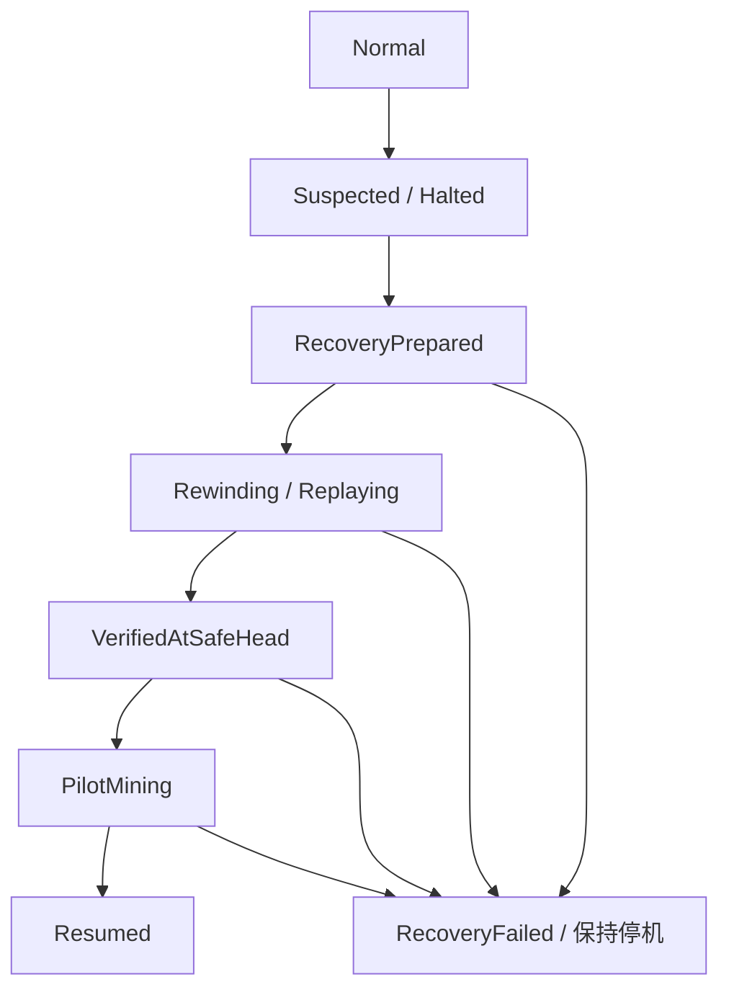

# USDB chain BTC 深重组恢复设计与实施计划

Document Type: Design and Implementation Plan
Status: Draft for Review, Non-Normative
Updated: 2026-10-24
Related UIPs: UIP-0000, UIP-0006, UIP-0007, UIP-0008, UIP-0009, UIP-0010, UIP-0011, UIP-0012, UIP-0013, UIP-0014, UIP-0018
Discussion: https://github.com/buckyos/usdb/issues/33
Related Governance Discussion: https://github.com/buckyos/usdb/issues/32

## 1. 目标与设计结论

本方案处理 BTC canonical history 被替换后，已经引用该历史的 USDB chain 如何停止、
保留有效前缀、统一回退并恢复出块。它将原讨论备忘录收敛为后续 UIP 与实现的评审输入。

本轮采用的设计方向是：

```text
自动检测并停机
  -> 核对 BTC 分叉与 USDB 受影响范围
  -> 批准并发布统一恢复文件
  -> 各节点归档、回退或重放
  -> 在安全区块核对一致性
  -> 少量矿工试运行并验证替代分支
  -> 恢复正常出块
```

BTC canonical history 继续作为 BTC-side USDB economic state 的权威来源。旧分支档案
用于审计，不赋予已经失效的 BTC 状态继续参与共识的资格。第一阶段自动化负责安全停机
和按已批准文件执行恢复；节点不根据各自即时 BTC tip 自行决定回退高度。

**需要独立的 Standards Track UIP。** 安全区块选择、区块有效性、废弃分支拒绝、
恢复授权与 fresh joiner 重放均影响共识，不属于纯运维流程。第 14 节定义 UIP 边界。
本次不分配 UIP 编号、不修改已激活协议，也不提供可在线执行的恢复命令。

文中“必须”等用语表示拟议设计约束；只有后续 UIP 和对应网络激活完成后，才能成为
该网络的规范要求。矿工 anchor gap、更多确认数和普通重试只能降低触发概率或改善可用性，
不能替代这套恢复机制。

## 2. 当前实现与缺口

以下为 2026-10-21 本地源码核对结果：USDB `f6b8be9`、go-ethereum `769233dab`。
源码核对不代表发布包或现网已具备拟议能力。

| 能力 | 当前情况 | 主要入口 |
| --- | --- | --- |
| Core 重启时保留相同历史前缀 | 已实现；高度降低本身不触发 BH 回滚，恢复期间暂缓查询 | `src/btc/balance-history/src/index/indexer.rs` |
| BTC-side 回滚和重放 | 已实现；indexer 对上游回滚持久记录本地 epoch | `src/btc/usdb-indexer/src/index/indexer.rs`、`storage/pass.rs` |
| 精确历史状态查询 | 已实现 `get_state_ref_at_height`，可校验历史 snapshot/system state | `src/btc/usdb-indexer/src/service/rpc.rs` |
| 深重组持久停机 | 已实现；guard 比较本地 epoch，写入 `halted.json`，runtime 停止 geth | Go `scripts/usdb/docker/usdb_deep_reorg_guard.py`、`usdb_runtime_node.sh` |
| 父子 BTC anchor 约束 | 已实现禁止 anchor 高度回退、同高换身份与超限复用 | Go `internal/usdb/anchor.go` |
| 网络统一恢复文件、安全区块规划、废弃分支拒绝 | 尚未实现 | 本方案新增范围 |
| `usdb-node recovery` 与矿工恢复门禁 | 尚未实现；已有 mining enable/disable 不能代替事故恢复 | `docker/scripts/tools/usdb_mining.py` |

现有 guard 是保守的本地停机保护，并未证明某次 indexer 回滚一定使 USDB 区块失效。
BTC-side 回滚完成、RPC 恢复或容器健康，都不表示旧 USDB chain 已能恢复。

[测试网旧操作规程](publish/usdb-testnet-v0-deep-btc-reorg-operations.md)明确适用于
`testnet-v0` 开发网络，采用归档旧链后建立新网络代次的办法。本方案不追认其他网络
已经具有该流程，也不授权在现网清除停链记录后继续旧链。

## 3. 事件分类与 finality 边界

### 3.1 分类依据

| 观察结果 | 目标处理方式 |
| --- | --- |
| Core 暂时降低高度，共有历史哈希一致 | 保留提交状态、等待 Core 恢复；旧版已经留下的停机记录另行审计 |
| RPC 超时、服务重启、历史尚未同步或证据不足 | 等待或安全停机；不能据此宣告区块无效 |
| 真实 BTC reorg，但没有 USDB 区块引用被替换状态 | BTC-side 重放；经完整影响分析可采用不回退 USDB 的恢复决定 |
| 真实 BTC reorg，已有 USDB 区块引用被替换状态 | 固定第一个受影响区块，统一恢复至其有效父块 |
| 分叉越过 bootstrap origin、历史不可重建或证据冲突 | 保持停机，进入专门的数据恢复或网络迁移评审 |

“深重组”的恢复判断依据是**实际引用的状态是否失效**，不是单看 BTC 回退了几块。
即使触发本地 epoch 变化，也必须先完成影响分析，不能直接按深度折算 USDB 回退数量。

### 3.2 stable lag 与 miner gap

当前相关网络配置使用 `stable_lag_blocks=10`；这是网络选定的参数，不是永久 finality。
[UIP-0018](UIP/UIP-0018-miner-btc-anchor-gap-policy.md) 的 miner anchor gap 是本地选高策略，
其建议值 2 不是所有矿工都必须遵守的共识条件；实际 gap 也可能因父 anchor 和复用上限而缩小。
不能把“10+2”当作全网保证的抗重组阈值，更不能让 validator 用生产者 gap 判断有效性。

增加确认数、gap 或未来引入 BTC header/SPV 验证，仍需回答已经接受的 USDB 历史是否
随 BTC 重组撤销。SPV 改善证据验证方式，不自动解决 finality 取舍。

### 3.3 未采用的替代方向

`archive and continue` 会永久保留曾经 canonical 的 BTC 状态，并让旧 USDB 区块继续有效。
它要求新节点能取得并独立重放完整 orphan state，也会使被 BTC 撤销的 pass、余额和能量
继续产生经济影响。本方案不采用该方向；未来若改变这一结论，须单独修改协议语义，
不能作为数据库归档优化悄悄引入。

## 4. 术语与不变量

| 术语 | 本方案含义 |
| --- | --- |
| earliest affected block | 在选定旧 USDB 分支上，第一个经证据确认其 BTC selector 已失效的区块 |
| safe USDB head | earliest affected block 的有效父块，固定 `number/hash/state_root` |
| recovery artifact | 绑定网络、BTC 分叉证据、恢复动作、安全区块及授权的规范化恢复文件 |
| network recovery epoch | 全网恢复决定的有序编号，与前一恢复文件的 hash 绑定 |
| local upstream reorg epoch | 现有 indexer 的 `upstream_reorg_epoch`，仅表示该数据库经历的回滚次数 |
| removed branch | 受影响区块及其所有后代；保留归档但不能重新成为 canonical history |
| fresh joiner | 从干净链数据库或获准检查点加入、独立验证恢复规则的新节点 |

不同节点的 local upstream reorg epoch 可以不同；漏过一次中间分叉、重建索引或旧版误判
都可能造成差异。禁止把该计数当作 network recovery epoch，也不要求把各数据库改成同一个值。

拟议恢复必须保持以下不变量：

1. 共识验证不读取验证节点的实时 BTC tip 来独立决定回退高度或 selector 新鲜度。
2. “不可查询”和“已证明不属于选定 canonical history”是两种不同结果。
3. 所有受影响后代一起退出 canonical chain；不能只删直接引用 orphan selector 的区块。
4. 归档先于破坏性回退；未完成恢复时，重启、`up` 和 mining enable 均不能绕过停机。
5. 旧节点和 fresh joiner 应在相同有效分支得到相同区块 hash、EVM state root 和系统状态。
6. 废弃分支即使累计工作量更高也必须被拒绝，且不能通过不同导入路径绕过校验。
7. BTC-side 状态在选定 BTC 分支收敛，USDB EVM 状态恢复到 safe head；两者不要求拥有相同
   数字高度，而是要求 safe head 与后续 selector 可按精确历史身份重放。
8. 拒绝与既定恢复决定冲突的文件；任一关键校验失败保持停机。

## 5. 确定安全区块与恢复动作

### 5.1 输入与验证顺序

planner 固定旧 USDB 分支的 head/hash、网络身份、BTC 分叉证据、新分支 anchor/hash、
适用 registry 和恢复规则版本，记录观测时间与证据摘要。建议事故评审使用至少两个独立
BTC 数据源交叉核对；这不把“两个 RPC 投票”定义成 BTC 共识，也不能替代本地全节点验证。

按 USDB block number 升序检查可能受影响的 selector，依据 UIP-0006/0007/0008 解析
历史版本、`btc_height`、`snapshot_id`、`system_state_id` 和所选 pass 的经济视图。
BTC fork point 和 anchor 索引可缩小扫描范围，但不能省略范围完整性证明。

每个检查必须返回以下之一：

- `valid`：该 selector 在固定的新 BTC 历史下仍可按预期身份与规则验证。
- `invalidated_by_btc_reorg`：有已核实的 BTC canonical mismatch 及其派生状态影响证据。
- `unavailable`：RPC、索引进度、历史保留或数据完整性不足，不能完成判断。

单独的 system-state mismatch 也可能来自本地损坏或实现错误，不能未经 BTC 分叉核对
就分类为真实重组。遇到 `unavailable` 或未解释的差异时，计划不可执行。

### 5.2 回退规则

第一个 `invalidated_by_btc_reorg` 区块记为 `B`，安全区块为其父块 `S`。
恢复文件固定 `S.number/hash/state_root` 和 `B.hash/parent_hash`；必须验证 `B.parent_hash=S.hash`，
并证明所保留前缀有效，而非仅发现一个较早的可查询块就停止扫描。

例如，BTC 的共同祖先为 100，USDB 第 5000 块首次引用旧 BTC 101 状态，则恢复到 USDB
第 4999 块。第 5000 块及其全部后代都退出 canonical chain，包括后来引用新 BTC 状态的后代。

节点可能处于不同本地高度：高于 `S` 的受影响节点归档并回退；低于 `S` 的节点按获准
前缀同步；fresh joiner 从有效前缀重放。同高度 hash 不同的本地分支必须单独验证适用性，
不得仅凭区块号执行操作。发生多次重组时，按第 6 节的恢复文件顺序处理。

### 5.3 不回退与不可恢复情况

若完整影响分析证明选定旧分支没有受影响区块，可提出 `resume_verified` 动作，保留链头。
它仍须绑定已核对分支、BTC 证据和适用范围；不是“看到 READY 就清 latch”。只对某台机器
发生的旧版误报，应保留本机审计记录，不伪造全网恢复事件。

若 `S` 的 trie state 已被裁剪，执行器可通过保留的有效历史、获准检查点或 fresh sync
重建，但最终必须核对精确 `S.hash/state_root`。`SetHead` 可能退到更早的有状态区块，
这只是实现中的重建起点，不能被静默接受为另一个全网 safe head。

若分叉越过 BTC-side bootstrap origin、必要历史无法重建，或者共同前缀已不受信任，
禁止自动选择新 bootstrap identity 或随意退到 genesis。此类事故转入单独迁移／网络重置
决定；第一阶段恢复器报告阻断原因并保持停机。

## 6. 恢复文件、授权与分支拒绝

### 6.1 拟议内容

以下为字段组设计，不是已冻结的 JSON schema：

| 字段组 | 必需信息 |
| --- | --- |
| 身份 | schema/policy version、network/chain ID、genesis hash、registry binding |
| 顺序 | incident ID、network recovery epoch、previous artifact hash |
| BTC 证据 | old/new branch、fork point、新 anchor height/hash、header/work 与派生状态证据引用 |
| USDB 决定 | `rewind` 或 `resume_verified`、被审计分支、与动作对应的区块边界 |
| 分支约束 | 失效的 BTC 状态身份、被废弃 USDB 分支根及后代拒绝规则 |
| 恢复输入 | BTC-side 状态摘要、历史保留要求、允许的 checkpoint 与其恢复历史绑定 |
| 兼容性 | 最低客户端能力、适用规则版本、激活和旧客户端处理要求 |
| 完整性与授权 | canonical hash、domain-separated signature、signer set/version 与授权证明 |

`rewind` 必须给出首个受影响块 `B` 及其父块 `S` 的 number/hash/state_root。
`resume_verified` 没有受影响块 `B`，应固定已经完整核对并保留的链头三元组；后续恢复验证
以该链头为目标，不得虚构失效区块或回退边界。

canonical encoding、hash 算法、签名算法、门限、密钥轮换和吊销规则需在 UIP 中冻结。
自哈希／签名计算排除哪些 envelope 字段必须明确定义。解析应拒绝 duplicate key、未知
必需字段／版本、错误网络、错误 parent/safe head、缺失证据和无效签名。

第一阶段采用显式授权恢复：发布者不能仅凭 GitHub Release 存在就获得任意改链权限。
节点从已信任的网络配置验证恢复授权，再独立复核 BTC 证据、分支和状态边界。
签名权与软件发布权的关系、签名者能决定的范围必须公开；不能把该治理信任描述为纯 PoW 自动恢复。

### 6.2 顺序与发现

恢复文件按 epoch 和 previous hash 形成可验证序列。相同文件重复应用应幂等；同一 epoch
出现不同 hash 必须拒绝并报告冲突。漏过事故的节点先补齐适用恢复历史，不能直接用最新
文件覆盖已有记录。新 release、恢复 registry 或检查点应提供可信的必需恢复历史绑定；
具体分发载体和防止陈旧视图的规则列为 UIP 冻结项。

恢复决定不能只能从已失效的 USDB 分支读取，否则停机节点和 fresh joiner 无法取得它。
下载失败或无法确定必需恢复版本时保持暂停，不能相信任意 peer 声称的“最新 epoch”。
签名不能证明 BTC 永不再重组；若所固定的新 BTC anchor 再次失效，停止当前恢复并经过
显式 superseding 决定处理，不能在原 epoch 下替换文件内容。

### 6.3 持续拒绝旧分支

拒绝规则至少覆盖首个失效 USDB 区块及其所有后代，以及其他继续引用已确认失效 BTC
状态的分支。只封禁一个旧 tip hash 不足以处理多个矿工分叉；只禁止一个高度之后的所有块
又会错误阻止合法替代链。

geth 的 fork choice、header/body 导入、已知块缓存、下载器、gossip、重启与检查点加载都
必须执行相同规则。不能因旧块已在本地通过过验证，或旧分支 TD 更高而重新接受它。
peer capability／隔离可改善诊断，但不能替代区块验证中的强制拒绝。

## 7. 恢复状态机与崩溃一致性



| 阶段 | 进入下一阶段的条件 |
| --- | --- |
| Suspected / Halted | 持久停挖、冻结受影响链导入、收集证据；当前 runtime 会停止 geth，未来只读诊断面需单独实现 |
| RecoveryPrepared | 恢复文件通过授权与本地复核，明确归档、状态重建和磁盘需求，执行计划经批准 |
| Rewinding / Replaying | 已归档旧数据；加载分支拒绝规则；BTC-side 收敛；执行层恢复或重放至指定安全区块 |
| VerifiedAtSafeHead | 多个独立验证节点与 fresh joiner 在 `S` 的 hash/state root 一致，历史 selector 可重放 |
| PilotMining | 获准的少量矿工生成替代分支；验证节点和 fresh joiner 接受并核对新块 |
| Resumed | 试运行达到事先约定的块数／观察窗口，各矿工通过资格检查后逐步恢复 |

先在安全区块验证，再试运行产生新分支；不能要求“所有人先验证尚未产生的新块”才允许
第一个矿工恢复。试运行节点数、块数和时间门槛须在演练后确定，不能用一次健康检查替代。

跨 geth、BH、indexer 和工具目录不存在天然的单个数据库事务。采用持久阶段日志、文件与
父目录 fsync、排他操作锁、前后置状态校验和最终启用门禁。日志绑定恢复文件 hash、
数据目录身份、原链头、目标、备份和每步结果。重复执行不能重复回退或提前恢复挖矿。

`recovery apply` 不直接删除 `halted.json` 后启动 miner。应保存原事故，持久记录恢复结果，
在验证通过后由 guard 验证授权恢复记录与该节点新的本地 epoch 基线；具体磁盘格式属于
实现设计。全网 epoch、本地 epoch 和文件 hash 都应可观测，三者不得混用。

失败或执行中断后按同一文件向前恢复；已经改变 canonical state 后，不提供简单“退回旧软件
继续旧链”的回滚承诺。需要撤销恢复决定时走独立、可审计的后续决定。

## 8. 状态、交易与应用影响

USDB chain 回退应恢复完整 EVM 状态：账户余额与 nonce、coinbase reward、fee split、
issued supply，以及 UIP-0011 至 UIP-0014 的系统 storage。禁止用额外反向转账补账。
替代区块重新执行交易和系统结算，不复用旧 receipts。

被撤销交易只可在重新验证签名、nonce、余额和依赖后 best-effort 返回 txpool；不保证
原顺序或再次成功。Explorer、control-plane、业务索引和事件消费者应能识别 removed logs
及恢复边界，并重建衍生视图。已经发生的链外结算无法靠 EVM 回退撤销，事故通知必须说明
受影响范围与业务补偿责任。

保留有效前缀的 rewind 不自动要求重新部署 SourceDAO；若部署／初始化交易位于 removed
range，则按新链实际状态重新执行必要交易。不要照搬“新 genesis 全网重置”的 bootstrap 步骤。
BTC-side 保留并收敛可验证的数据；不得为了重同步 USDB chain 无差别删除 BTC、Ord 或索引库。

## 9. 组件职责与节点工具

| 组件 | 需要补充的能力 |
| --- | --- |
| balance-history | 持久提供 fork point、old/new hash、回滚范围和状态证据；在真实回滚破坏旧视图前保存足够证据 |
| usdb-indexer | 历史 selector 批量核验、明确 unavailable/mismatch 分类、回滚事件摘要和精确状态复核 |
| go-ethereum | 扫描 selector／索引受影响范围、验证恢复决定、执行状态回退／重放、持久拒绝废弃分支 |
| guard/runtime | 持久暂停、验证恢复记录、区分本地 epoch 与全网恢复序列、重启时继续执行门禁 |
| usdb-node | 只读规划、归档、执行编排、排他锁、断点恢复、进度、审计与矿工恢复控制 |
| 发布与监控 | 分发可信恢复历史、展示最低版本和受影响范围、将停机与恢复阶段提供给运维和外部消费者 |

拟议 CLI 如下，**当前尚不存在，不可作为线上操作命令使用**：

| 拟议入口 | 行为边界 |
| --- | --- |
| `usdb-node recovery inspect` | 只读显示当前事故、链头、epoch 和证据可用性；导出应显式指定私有目录并脱敏 |
| `usdb-node recovery plan --artifact FILE` | 只读验证文件，列出受影响范围、备份路径、重建需求及阻断项 |
| `usdb-node recovery apply --artifact FILE` | 显式确认后执行；可重复调用并从已持久完成阶段继续；保持 mining disabled |
| `usdb-node recovery verify` | 核对实际区块 hash/state root、BTC-side 历史身份、恢复记录及节点一致性证据 |
| `usdb-node recovery resume-mining` | 绑定本次恢复决定、试运行许可和当前矿工资格；普通 `up` 不自动恢复矿工 |

命令解析、服务控制、私有数据保存属于实现细节；区块有效性不能只靠 Python 编排器保证，
直接运行 geth 也必须执行协议规定的恢复与分支拒绝规则。运维界面不暴露通用的
`--force-unhalt` 或任意 `--height` 来跳过证据与恢复授权。

## 10. 矿工和发布操作

### 10.1 矿工恢复顺序

1. 停挖意图持久化，清理旧组块任务；保留地址和线程等配置，但不保留自动恢复出块权限。
2. 安装支持恢复规则的客户端与 node kit，取得并验证本次统一恢复文件。
3. 完成 BTC-side 收敛与 USDB 执行层恢复，先以验证模式到达 `VerifiedAtSafeHead`。
4. 在 replacement BTC history 上重新检查 MinerPass 存在性、owner、Active 状态、energy、
   selected pass 资格与所需版本；mint、transfer 或 remint 可能已被 BTC 重组撤销。
5. 在获准试运行阶段恢复少量矿工，取得新旧节点对替代分支一致的证据。
6. 逐步恢复其他矿工；每次启用前重查前置状态，BTC 再次重组或恢复文件变化则停止。

不自动重发铭文、不自动转移 pass、不绕过资格检查。anchor gap 仍只是正常矿工策略，
恢复后的区块继续遵守父 anchor、身份和 age 规则，不能为尽快出块临时降低共识要求。

### 10.2 首次引入能力

首次发布需要新的协议规范及网络激活决定，配套 Go 客户端、BTC-side 服务、node kit、
恢复工件格式和测试夹具。须更新兼容锁和最低客户端要求；矿工、validator、bootnode、
fresh joiner 和提供数据的查询节点都在发布范围内。

能力引入与单次事故应用是两个层次。正常运行网络可预先激活能力；对尚不支持该能力的
已停机网络，需要显式的应急升级／激活方案，不能仅安排一个永远无法到达的未来区块高度。
`recovery_policy_version` 等新字段及其放置位置尚待 UIP 冻结，不在本次改写 registry/genesis。

保留同一 genesis 的恢复不等于普通数据兼容升级；旧客户端可能不理解新有效性规则。
是否能保留 chain/network ID、怎样处理旧节点与未更新的 bootstrap，必须由网络激活方案
说明。不要只标记 `restart_required` 就宣称恢复已兼容。

### 10.3 后续事故与版本管理

当客户端已支持相同恢复规则时，后续事故原则上可以只分发新的获准恢复文件；只有格式、
规则、缺陷或能力不兼容时才需要新二进制。文件应通过不可变、可校验的分发渠道发布，
与适用版本和之前的恢复历史绑定，不能覆盖旧 release asset 或同 epoch 的文件。

同一 `rN` 只是软件发布号，既不是恢复编号，也不是网络代次。若采用新 genesis 的
网络重置，另走网络迁移流程，不能把它包装成保留前缀的 rewind。

## 11. 分阶段实施计划

| 阶段 | 范围与主要产物 | 完成门槛 |
| --- | --- | --- |
| P0：规范与证据模型 | 冻结分类、安全区块算法、授权与恢复序列；编写独立 UIP Draft 和错误语义 | 协议评审识别所有待定参数，不存在隐含“任意清 latch”路径 |
| P1：只读 planner | BH/indexer 事故证据、Go selector 扫描、`inspect/plan` 和案例报告 | 三类事件正确区分；数据不足明确阻断；不修改服务和数据库 |
| P2：受控恢复内核 | geth artifact 校验、分支拒绝、精确状态回退／重放、guard 持久恢复记录 | 已知块、TD 更高旧分支、重启和 fresh joiner 均不能绕过规则 |
| P3：节点与矿工编排 | `apply/verify/resume-mining`、备份、操作日志、崩溃恢复、control-plane 展示 | 全阶段故障注入幂等；未验证前任何启动路径都保持停挖 |
| P4：跨节点演练 | 独立 BTC/BH/indexer、多矿工、多验证节点、fresh joiner 与应用索引 | 恢复前缀与替代分支精确一致，奖励／供应量／系统状态一致 |
| P5：发布与网络激活 | 固定版本镜像、恢复文件、最低能力、运维 runbook 与事故通知 | 候选发布包完整演练；正式网络完成规定的激活与恢复验收 |

P1 可在规范评审期间做只读原型。P2/P3 在隔离 regtest 中验证，不能因原型可运行就开启
生产恢复。保护用户历史和节点数据的备份／恢复约定必须先于任何可写实现。

## 12. 验收矩阵与 CI 落点

下表为拟议验收任务，尚未实现或接入 CI，不是已有通过记录。

| 层级 | 必须覆盖的场景 |
| --- | --- |
| Fast | 三类事件与错误分类；canonical 编码、重复键、签名、网络／版本错误；epoch/hash 冲突；safe head 算法；矿工门禁 |
| Nightly | 独立 BTC 分支真实 regtest；替换已引用 stable block；不影响任何 selector；同高换 hash；多块复用与多个矿工分支；状态回退和重放 |
| Weekly | 连续多次 reorg、恢复中再次 reorg、离线节点跨多个 epoch、较长历史／裁剪状态、阶段崩溃恢复、多个独立节点与 fresh joiner |
| Release qualification | 使用候选 manifest 与 digest-pinned 镜像完整演练停机、升级、恢复、试挖、全面恢复及再次重启 |

跨层必须断言：

1. Core 临时低高度、RPC 中断和 lag/gap 边界不会被当作失效区块证据。
2. 首个受影响区块及其全部后代被撤销，安全前缀 hash/state root 不变。
3. 奖励、fee split、issued supply、系统 storage、receipts 和业务索引与全新重放一致。
4. 已知块缓存、gossip、downloader、更高 TD、直接运行 geth、旧 checkpoint 和重启均不能
   让废弃分支重新成为 canonical；另一条仍有效的替代分支不会被按高度误禁。
5. 相同文件重复应用、同 epoch 冲突、缺失历史、错误签名、错误网络和数据目录身份均有确定结果。
6. 每一写入阶段被 SIGTERM、SIGKILL 或进程崩溃打断后，只能安全续跑；VM／断电验收另行标注，
   不能把进程测试当成真实掉电证明。
7. fresh joiner 从 genesis 或获准 checkpoint 获得相同恢复历史，验证安全区块与试运行的新块。
8. MinerPass 在新 BTC 分支不存在、owner 改变或资格失效时拒绝恢复该矿工。
9. bootstrap origin 被跨越、trie state 被裁剪、磁盘不足和证据不可用时保持停机，不静默清库。

每次演练记录源码／镜像版本、BTC old/new hash 和 fork point、USDB 受影响范围、安全区块
三元组、恢复文件 hash、全网与本地 epoch、各阶段耗时及备份位置。长跑设定可解释的超时预算，
保留原失败现场；只重跑较短片段不能替代完整恢复验收。

## 13. 尚需评审冻结的事项

| 事项 | 本轮方向 | 未冻结内容 |
| --- | --- | --- |
| finality 策略 | BTC canonical authority + deterministic rewind | 超出恢复范围时的治理／迁移边界 |
| 事件判定 | 哈希／身份冲突证据；unavailable 不等于 invalid | 证据格式、保留时点、复核数据源要求 |
| 授权 | 显式授权文件 + 节点独立复核 | signer、门限、算法、轮换、吊销、与 release 签名的关系 |
| 文件历史 | epoch + previous hash；不可覆盖冲突决定 | 可信发现、陈旧视图防护、registry／manifest／链配置的职责 |
| 恢复范围 | 只保留可验证前缀 | 最大范围、bootstrap origin 与历史不足的退出条件 |
| 客户端兼容 | 验证器强制规则，覆盖 fresh joiner | 版本字段、网络激活、旧客户端隔离、既有停机网络升级方式 |
| 矿工恢复 | 安全区块验证后试挖，再逐步恢复 | 独立节点数、试挖块数、观察窗口、批准主体 |
| 可用性目标 | 记录完整恢复成本 | RTO、历史／备份容量、可接受停机时间与演练规模 |

这些未决项不能用实现默认值或发布脚本临时填补。第一轮应先冻结授权和客户端有效性边界，
再实现可写恢复内核。

## 14. 独立 UIP 的定位与推进

### 14.1 为什么是 Standards Track

依据 [UIP-0000](UIP/UIP-0000-uip-process.md)，影响共识、验证、状态承诺或经济结算的规则
应使用 Standards Track。拟议独立提案可暂称 **BTC Reorg Recovery and Canonical History**，
Layer 覆盖 Consensus / Validator / Recovery；编号在进入正式提案流程时分配。

| 文档 | 负责内容 |
| --- | --- |
| 新 Standards Track UIP | orphan state 是否有效、安全区块算法、恢复授权与排序、分支拒绝、历史重放、状态语义、兼容与激活 |
| 本设计与实施计划 | 组件拆分、持久执行、备份、CLI 设计、阶段安排和验收组织 |
| 后续运维 runbook | 已发布能力下可直接执行的操作、进度判断、备份位置和故障处理 |
| 可选 Process UIP | 只有需要独立、长期治理规范时，再拆分人员审批和事故协调流程 |

签名授权的验证规则即使具有治理属性，仍直接决定区块历史是否可接受，必须属于
Standards Track 的规范边界；不能全部藏在 Process UIP 或运维手册中。

### 14.2 与现有 UIP 的衔接

- UIP-0006：引用精确历史查询和错误语义，补充恢复 planner 所需的稳定分类。
- UIP-0007：保持 selector 与父子 anchor 约束，定义恢复决定如何影响其有效性与分支选择。
- UIP-0008/0009：定义恢复规则版本、可信恢复历史绑定、网络激活、客户端兼容和 bootstrap。
- UIP-0010 至 UIP-0014：规定既有经济／系统状态随执行层重放恢复，不另写补偿公式。
- UIP-0018：仅提供矿工选高缓冲，不承担 finality、事件判断或恢复授权。

### 14.3 推进顺序

1. 评审本方案，确认策略和授权模型边界，将未冻结事项列为 UIP 的显式 TODO。
2. 分配独立编号并提交 `Draft / Standards Track`，按 UIP-0000 提供激活矩阵、受影响版本字段、
   向后兼容和规范测试向量；此时不要求生产实现已完成。
3. 用 P1/P2 原型验证算法、错误语义与状态边界，评审后进入 Review，逐项消除阻断性 TODO。
4. 经 Last Call／Final 及相应网络激活流程，完成 P4/P5 演练后才开放正式恢复能力。

`Draft` 可以先于实现，`Final` 也不自动等于任一网络已激活。当前代码、原有测试网重置规程
和本设计必须持续区分，避免把文档评审通过误当成线上解除停链的授权。

## 15. 关联文档

- [BTC Reorg 风险现状与改造计划](btc-reorg风险现状与改造计划.md)：BTC-side 回滚背景。
- [Core 重启恢复等待与持久事故](handbook/node/observations.md)：当前可观测行为。
- [测试网旧深重组操作规程](publish/usdb-testnet-v0-deep-btc-reorg-operations.md)：testnet-v0 重置边界。
- [发布与数据兼容契约](publish/usdb-network-data-layout-and-release-compatibility.md)：数据身份与 release 边界。
- [节点挖矿操作设计](publish/usdb-node-mining-operations-design.md)：现有矿工配置与资格门禁。
- [UIP 目录](UIP/README.md)：规范状态、术语与各提案入口。
